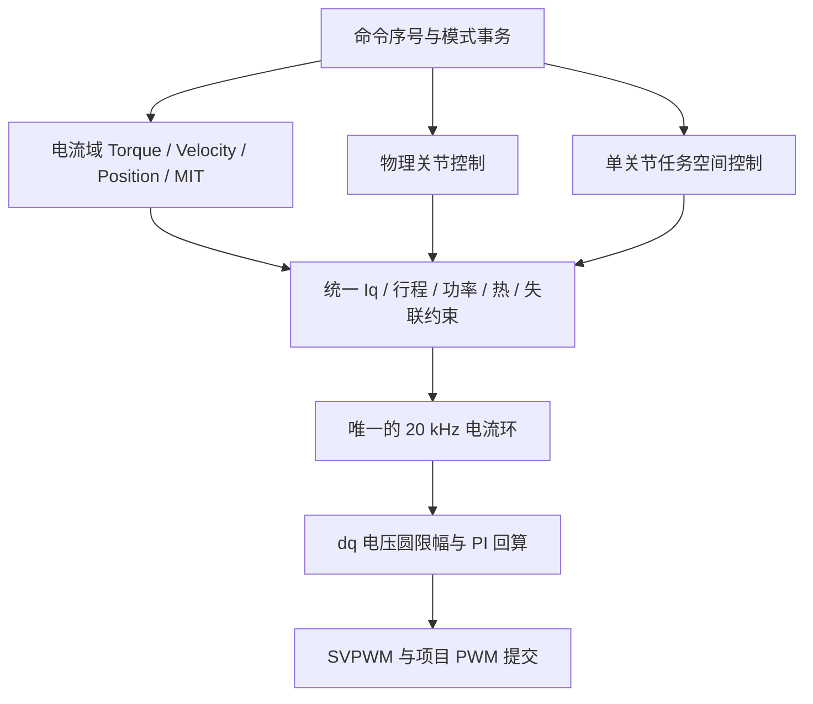

# 电机交互控制与执行约束

本文件描述已实现的 C++ 算法、`demo_foc` 接线和使用条件。代码接入与主机仿真通过，不代表电机台架、接触稳定性或功能安全认证。
基础标定、硬件与原有协议见 [电机算法](MOTOR_ALGORITHMS.md) 和 [产品说明](../app/product/demo_foc/README.md)。

## 分层与执行链

- `<algo/motor.h>`：反馈、现有电流/速度/位置/MIT 控制、标定、诊断、执行限制。
- `<algo/interaction.h>`：力矩映射与拟合、关节阻抗/惯量整形、导纳、拖动、力控、夹持、弹性关节观测、补偿。
- `<algo/robotics.h>`：固定 1～7 关节串联链、运动学/Jacobian、逆动力学和任务空间交互控制。
- 三者只计算数值、使用定长状态，不依赖 RTOS、驱动、协议或动态内存。
- `demo_foc/control/interaction_control.cc` 负责单轴模型与产品连接；配置/协议/Flash 位于产品层。



关节控制/监督以 4 kHz 执行，温度和存储由 1 ms 服务管理。相电流/I²t 在 20 kHz 路径计算。
模式互斥，新增算法不启动第二个电流环或 PWM 所有者。旧模式的 PID/LESO/规划与新的交互控制器按模式选择，导纳不再叠加旧位置规划器。

## 模式与物理量

| 模式值 | 能力 | 必要条件 |
| --- | --- | --- |
| 0～3 | Torque/Iq、Velocity、Position、MIT | 沿用既有 A、rad、rad/s 与字节增益约定 |
| 4 | 物理力矩前馈 | 标定的输出关节 Nm/Iq-A 映射；它本身不构成实测力矩闭环 |
| 5 | 物理关节阻抗 | `K(qd-q)+D(vd-v)+tau_ff`，K 为 Nm/rad、D 为 Nm·s/rad |
| 6 | 关节导纳 | 新鲜的外力矩或显式启用且校准的弹性模型；内伺服刚度 > 0 |
| 7 | 柔顺拖动 | 导纳的零外力参考；同样要求内伺服、外力与补偿条件 |
| 8 | 力闭环 | 实测传递力矩/接触力或有效弹性模型；已知接触力臂 |
| 9 | 夹持 | 接近、接触消抖、恒力保持、显式释放、结束/故障状态机 |
| 10 | 弹性关节阻抗 | 已校准双端形变和弹性刚度；增加相对速度阻尼 |
| 11 | 笛卡尔阻抗 | 已知运动学与力矩映射；通过 Jacobian 转置输出关节力矩 |
| 12 | 力/运动混合控制 | 选择轴上的力 PI，其余轴阻抗；新鲜世界坐标系外部 wrench |
| 13 | 笛卡尔导纳 | 六维虚拟机械状态与力输入；Jacobian 转置内伺服 |
| 14 | 关节惯量整形 | 实际负载惯量、期望惯量和可信外力矩均已明确 |

`demo_foc` 实例化单关节链：绕世界 Z 轴转动，工具沿本地 X 轴，长度、质量、质心和惯量可配置。
因此只能控制该机构 Jacobian 所覆盖的运动/力分量。三维位置和姿态指令会投影到可达自由度，单电机不能独立控制六维任务。
通用多关节调用示例在 [interaction_control](../samples/interaction_control/main.cc)，包含两轴与弹性环境的力位混合闭环仿真。

### 力矩与反馈坐标

物理映射为 `tau_joint = k * Iq_raw + bias`；逆变换只在末端执行一次。k 包含方向、减速比及所标定工况的传递关系，不再乘第二次减速比。
`MotorParameters::kt_coefficient=3.5` 仍只是既有元数据，不作为物理 Kt 使用。默认 k=0，物理模式拒绝启动。

`TorqueCalibration` 对实测输出力矩和实时原始 FOC Iq 拟合 k/bias，要求至少 3 个样本且电流具有足够跨度，输出 RMS。
产品只允许在电流 Torque 模式采点、停止后提交，RMS 必须不超过 `max(0.01 Nm, 5% torque_limit)`；写回校验成功后生效。
传感器先去皮、固定姿态并消除外载变化；截距不能任意解释成全工况不变的电机力矩。正反向、温度、减速器效率与静摩擦须另行核验。

三个关节输入不可互换：

| 输入 | 正方向与含义 |
| --- | --- |
| external_nm | 环境施加到关节的力矩，正值沿 +q；用于导纳/惯量整形 |
| effort_nm | 测得的执行器传递力矩，正值沿 +q；用于力闭环 |
| force_n | 非负夹持接触力，经 `closing_direction * lever_arm_m` 转为传递力矩 |
| wrench[6] | 环境施加到工具的世界坐标系力 XYZ/N、工具点力矩 XYZ/Nm |

任务空间目标 wrench 表示执行器希望施加的力，混合控制误差为 `wrench_des + wrench_environment`，达到平衡时两者相反。
导纳使用相同符号：虚拟质量受到外界 wrench 与目标执行器 wrench 的合力。

旧速度/MIT 阻尼继续使用转子折算的关节速度。新增物理关节控制使用输出 TMR 的速度；弹性观测另保留转子折算速度。
输入转子折算位置与输出位置必须对齐零位、方向、减速比和采样延迟，不能把任意双编码器差值直接当作弹性力矩。

## 交互控制数值细节

### 关节阻抗、惯量整形与补偿

旧 MIT 和物理阻抗共用 `spring_damper()`，分别保留自己的单位及各项/总量限制。
物理控制提供刚度/阻尼变化率、力矩变化率、统一 Iq 限制和最终应用值回算。新模式从当前实际 Iq 对应的力矩衔接；同模式新目标不重启过渡。
模式确认以 20 ms 过渡窗口和实际电流驱动成立为准，不表示机械位置或接触力已经收敛。

惯量整形用于已知单轴模型 `J*qdd = tau + tau_ext - compensation`，实现：

```text
tau = J/Mdes * (K*(qd-q) + D*(vd-v) + tau_ff + tau_ext) - tau_ext + compensation
```

当前目标加速度前馈为 0；用于调节/恒速参考，不能宣称已实现任意加速度轨迹的精确计算力矩跟踪。
实际惯量和外力不可用时拒绝启动。虚拟质量的离散稳定性不等于真实接触系统的稳定性。

补偿统一包含重力常数/正弦项、黏性摩擦、平滑 Coulomb/Stribeck 型摩擦、64 点周期齿槽表和带速率限制的反向背隙偏置。
摩擦幅值为 `Fc+(Fs-Fc)/(1+(v/vs)^2)`，平滑方向为 `v/(abs(v)+vsign)`；这些是待辨识的模型，不是默认实测参数。
齿槽表按输出关节角每 2π 周期插值；需要转子周期补偿时应先转换/采样成符合此坐标约定的表。
背隙标定值不等于弹性刚度，不能替代弹性参数辨识。

### 导纳、拖动与参考投影

```text
M*xdd + B*xd + K*x = tau_external - tau_reference
v_next = (M*v + dt*(effort - K*x)) / (M + B*dt + K*dt^2)
```

先用后向 Euler 解阻尼/刚度，再施加位移、速度、加速度、jerk 和力死区约束。
位移达到虚拟限位时清除向外的速度/加速度；产品配置行程后，将接受的参考位置回写虚拟状态，避免限位后继续积累隐藏位移。
拖动以进入模式时位置为原点，外力参考为 0；关节导纳以 `-tau_ff` 为环境力参考。
末端和关节导纳共享同一个标量数值原语。

### 力控、夹持与柔性传动

力 PI 包含目标力矩前馈、测量误差反馈、速度阻尼、输出/变化率限制，并回算最终应用力矩，包含后级 Iq/功率/能量约束的影响。
夹持流程只在明确释放目标 `force_n=0` 时回撤；普通 Stop 直接断能，不擅自打开夹爪。
接近时间、最大行程、接触消抖、失去接触、释放超时和传感器过期均有退出路径。

弹性观测：`tau_s = Ks*deadband(q_motor/N-q_load-zero, gap)+Bs*(v_motor/N-v_load)`，低通后作为弹性传递力矩。
外力估计为 `Jload*acc_load + gravity/friction - tau_s`。`use_model_external` 默认关闭；启用前必须确认弹性、惯量和补偿模型。
相对速度阻尼用于抑制传动振动，不包含未经验证的两惯量最优控制或硬件共振认证。

### 能量预算

关节物理控制可启用有限的正功预算：在**最终 Iq 限制后**按 `(k*Iq+bias)*v_load*dt` 扣减能量，必要时降低力矩。
负功不补入预算，避免把未实测的再生能量当作可用能量。预算与最终应用值可查询。
预算在开始新控制会话时重置；它不是跨会话的物理储能测量。模型误差、延迟、外部供能、增益变化和机械制动仍需系统级分析，不能据此声称已证明被控对象无源。
任务空间控制使用其力矩/变化率限制和共同执行约束，不自动套用标量关节的能量预算。

## 多关节运动学与动力学

`SerialChain<N>` 支持旋转/移动关节、前后固定变换、质心、质心惯量、反射转子惯量及工具变换。
提供 FK、几何 Jacobian（线速度在前、角速度在后）、`J^T*wrench`、递归 Newton-Euler 逆动力学、质量矩阵和重力/Coriolis 偏置。
逆动力学的工具输入是**需要执行器克服的阻力**，与外部环境输入互为相反数；均在工具点、世界坐标系表达。
单固定轴偏置采用与递推等价的解析式，减少 MCU 体积。没有运行时矩阵尺寸、堆分配或 Eigen 依赖。

`CartesianController<N>` 提供姿态最短旋转误差、阻抗、六维导纳、力位选择、动力学前馈及最终力矩/变化率限制。
混合力积分器通过统一缩放回算处理关节限幅，奇异位形不求 Jacobian 逆矩阵。
7 轴可启用阻尼投影的零空间姿态项，使用固定 6×6 Cholesky；它是带正则化的运动学投影，允许小量任务泄漏，不是严格动力学一致的零空间/任务优先级求解器。
接收同步的 q/qd、世界 wrench；多电机同步采样、机构模型与通信调度由上层负责。

## 执行监督与 FOC

`ExecutionLimits` 对普通控制、标定和诊断共用相电流/I²t、速度、硬行程边界及温度失效监督。
I²t 采用 `2/3*(Iu²+Iv²+Iw²)` 与连续电流平方的超额积分，覆盖 d 轴励磁；断能后按连续电流能力冷却，热积分未降至阈值 10% 以下不得清除。配置替换保留既有热积分和故障，不能通过修改无关参数清掉热状态。
普通控制另有命令失联和可配置的跟随误差。应用序号重复/旧帧以及旧时间戳的旧式 Target 不刷新命令期限；外力序号重复也不刷新有效期。
温度无效和温度服务停止更新都有期限，不会无限使用旧的有效温度。

默认软件值为相峰值 6 A、连续 dq 等效 2.2 A、超额 I²t 4 A²s、关节速度 40 rad/s、Iq 变化率 1000 A/s、普通命令 0.5 s、温度 0.1 s、90～120 °C 线性降额。
这些不是硬件额定值证明。行程/跟随误差/功率约束默认未启用，必须按机构填写；校准转动也会受到已配置的行程/速度/热保护。
软行程阻止向外力矩，硬行程越界锁存故障；软行程不是带制动距离预测的运动规划器。

功率可选择输出机械模型 `(k*Iq+bias)*v`，也可使用前一周期实际 alpha-beta 电压与当前测量电流估计的 `1.5*(Ualpha*Ialpha+Ubeta*Ibeta)`。
电气估计用于反馈削减，不是直流母线功率传感器，也不能证明母线不会再生过压。驱动/再生预算分别设置，0 表示不启用该预算。
软件限幅不能代替硬件短路保护、母线吸收通道或制动器。

电压限幅为 `norm(Ualpha_beta) <= 0.95*Vbus/sqrt(3)`，覆盖所有电压激励路径；电流 PI 跟踪限幅后可实现的 dq 电压。
电气模型前馈可选启用：`Ud_ff=R*Id-w*Lq*Iq`，`Uq_ff=R*Iq+w*(Ld*Id+flux)`；速度是转子电角速度。
`ElectricalIdentifier` 用前一 PWM 区间的实际电压和相邻电流做带截距 RL 回归；ISR 使用 float 补偿累加，求解放在慢路径。
要求静止/足够激励/至少 128 样本、正 R/L 与 RMS < 0.05 V；任一采样转子速度超过 1 rad/s 会拒绝该次拟合。
只有诊断正常结束且采流/Vbus 标定有效才允许提交。单轴锁定方向的有效 L 不能区分 Ld/Lq 或磁链，提交会保持解耦关闭，后续须独立确认模型再启用。

## 参数、协议与恢复

见 [交互控制工具](../tools/demo_foc/INTERACTION.md) 的完整字段与操作流程。
Link 帧格式仍为 v1；原模式事务 body v1/32 B 保留，新物理/任务空间目标使用 body v2/40 B 或 88 B。
旧 Status 49 B 保留；新模式状态/观测使用版本 2 表达模式号，不把 Nm 冒充旧命令中的 A。

10 个配置分区通过同一个字段访问器驱动读写与持久化，避免参数读/写/存储各自维护不同表。
完整配置以显式 LE float32、bool=0/1 编码，使用独立 NVS 记录 `0x4100`、MCAL 类型 INTC/version 1；保留原 `0x4000..0x4008` 标定记录及 Flash 分区。
只在空闲状态替换：校验候选 → 停 PWM/ADC → 写入 → CRC/字节回读 → 发布 → 恢复采样。写失败保留活动配置；启动发现损坏的新配置会阻止电机服务启动。
每个分区写入都保存完整配置；不是多个分区跨命令的原子事务。主机与固件字段数量必须匹配，未知版本/非有限数/非 0/1 bool 拒绝。

Stop/故障保持本地禁止使能；模式事务先确认 Disable 后才能重新使能。任何模型或传感器无效的退出都使电机断能，挂载负载时必须另有机械支撑。
温度独立通道的电压、温度和 present/valid masks 已通过 Observe kind=3 提供。
既有标定记录按启动时加载；本次没有新增设备身份管理、CANopen 栈或带电重新加载全部校准记录的流程。

## 验证与上板边界

主机用例覆盖已知 R/L 拟合、力矩线性拟合、限幅恢复、后级反积分饱和、导纳投影、最终正功预算、夹持状态、过期反馈、序号去重、质量矩阵对称正定、重力解析值、Jacobian 有限差分、功率一致性、π 姿态误差和 7 轴零空间。
两轴仿真验证接触力与另一轴位置同时收敛；它不替代实物环境刚度、延迟和摩擦变化实验。

安全回调使用电机实例作为非空上下文；产品构建额外检查电流、关节、慢服务及启动回调的 ELF 保留情况，防止初始化失败路径被优化后只留下可链接但不可运行的镜像。

上板前应完成：

1. 空载/受约束台架验证 ADC/PWM 相位、全部控制分支最坏耗时、任务栈高水位和看门狗退出。关节 IRQ 屏蔽快环期间也计入 50 us 快环延迟预算。
2. 测量 Iq/输出力矩映射、双传感器符号/零位/时延、温度与电流标定，确认行程和过流阈值。
3. 逐项注入过流、I²t、超速、软硬行程、跟随误差、命令/外力过期、温度断线和再生功率超限。
4. 从低增益开始验证接触/释放、软硬环境、载荷变化、共振及模型误差；惯量整形/弹性力估计必须与独立测量对照。
5. 输出 TMR 标定约需 1.2 圈输出运动，背隙每分支需覆盖 2π；不能越过机构行程执行。

GNU 产品构建采用局部 LTO/体积优化；初始化栈和慢服务栈各预留 8 KiB。构建体积和静态栈分析不能代替板上中断时限/栈高水位证据。
MTPA、弱磁、HFI 与无传感器启动不属于本单轴交互控制产品的已接入能力；其他组件存在相关代码不代表此执行链已支持。

## 本次软件验证记录

主机 C++ 32 项、电机工具 Python 14 项、工具链/生成器 Python 62 项、bootloader Python 30 项通过。
默认、Debug、Release、RT-Thread 固件以及 gimbal 回归构建通过；电机产品同时检查启动/故障结构与控制回调保留。
三镜像工厂包通过原分区布局检查。代码审计和依赖清单检查通过；未执行上板烧录、硬件采样、实物力矩标定或接触试验。

| 构建 | bin 加 128 B 镜像头 | RAM 链接预留 |
| --- | ---: | ---: |
| 默认 FreeRTOS | 152288 B | 115912 B |
| Debug | 152384 B | 115912 B |
| Release | 153512 B | 116920 B |
| RT-Thread | 150068 B | 80832 B |

以上应用镜像均小于原 155648 B 限额；三合一文件为 204800 B。RAM 预留包含静态资源/RTOS 堆等，不等于实测峰值。
